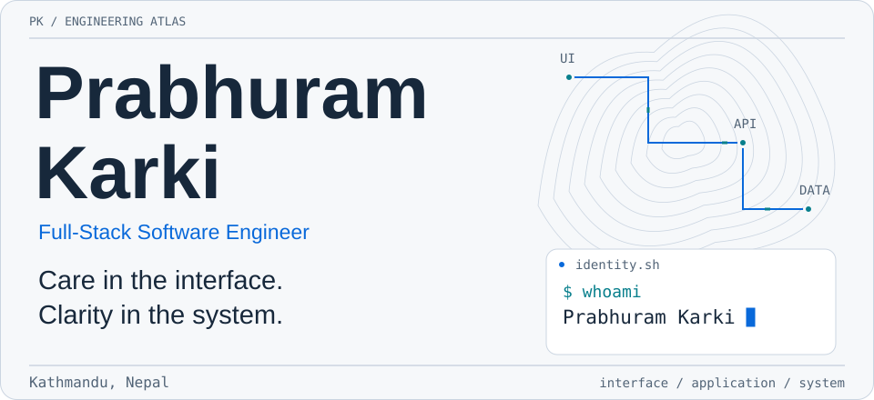
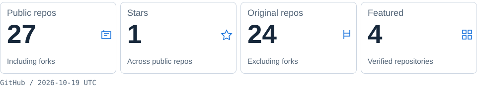
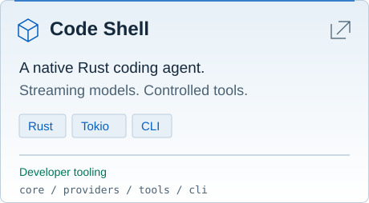
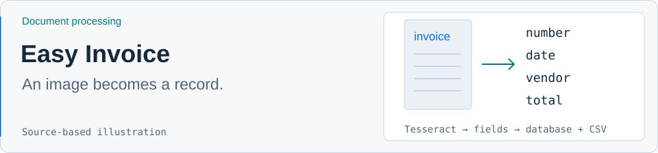
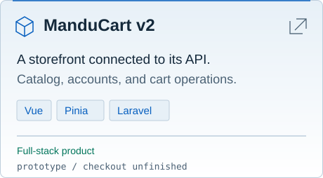
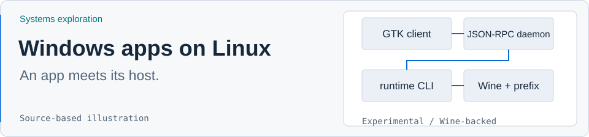
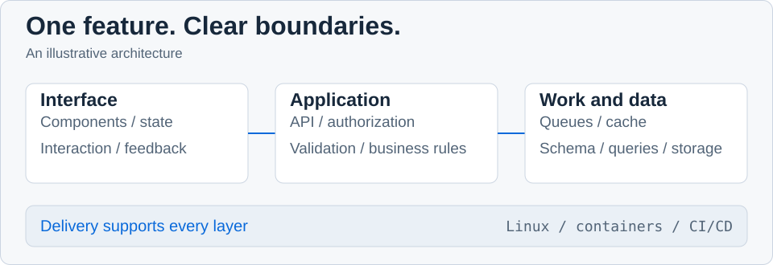
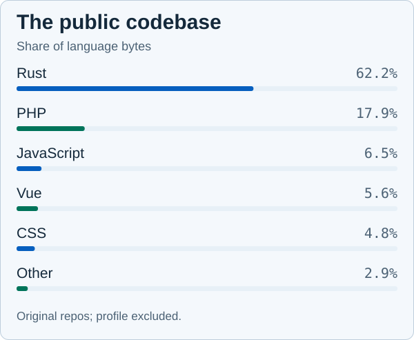
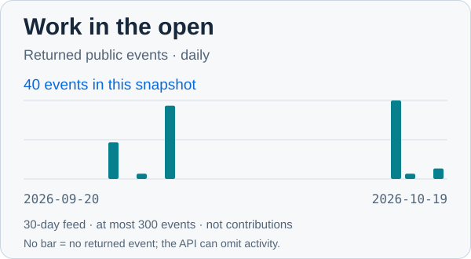
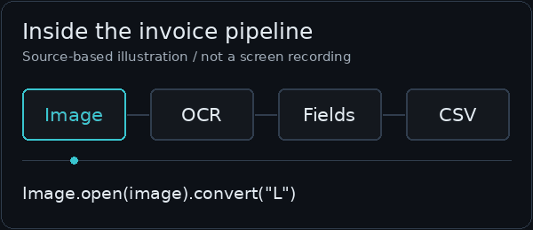

<picture>
  <source media="(max-width: 480px) and (prefers-color-scheme: dark)" srcset="assets/hero/hero-mobile-dark.svg">
  <source media="(max-width: 480px)" srcset="assets/hero/hero-mobile-light.svg">
  <source media="(prefers-color-scheme: dark)" srcset="assets/hero/hero-dark.svg">
  
</picture>

**[Portfolio](https://www.prabhuramkarki.com.np)** &nbsp; / &nbsp; [Selected work](#selected-engineering-work) &nbsp; / &nbsp; [LinkedIn](https://linkedin.com/in/prabhuramkarki) &nbsp; / &nbsp; [Email](mailto:prabhuramkarki07@gmail.com)

I build across the interface, API, and data model, primarily with **Vue, Nuxt, Quasar, and Laravel**. I care about a feature’s whole path: what people experience, the rules behind it, and the code someone will maintain next.

My public projects also venture below the web stack: a Rust coding agent, document processing with OCR, and an experimental Windows application runtime for Linux.

<picture>
  <source media="(max-width: 480px) and (prefers-color-scheme: dark)" srcset="assets/dashboard/overview-mobile-dark.svg">
  <source media="(max-width: 480px)" srcset="assets/dashboard/overview-mobile-light.svg">
  <source media="(prefers-color-scheme: dark)" srcset="assets/dashboard/overview-dark.svg">
  
</picture>

[Public data snapshot](assets/dashboard/data.json) · [Metric definitions and refresh schedule](docs/dashboard.md)

## Selected engineering work

Four public repositories, four different engineering problems. The covers below are custom illustrations; source links show the actual implementations.

### [Code Shell](https://github.com/prabhuramkarki/code-shell-rs)

<a href="https://github.com/prabhuramkarki/code-shell-rs">
  <picture>
    <source media="(prefers-color-scheme: dark)" srcset="assets/projects/code-shell-dark.svg">
    
  </picture>
</a>

**A coding agent in a native Rust CLI.** Work with a codebase through an interactive terminal or scripted prompts. Four crates separate the agent loop, streaming providers, tools, and CLI; tool calls pass through a permission engine, file edits produce diffs, and shell commands have a timeout.

`Rust` `Tokio` `SSE` `CLI` `LLM tool calling`

[Repository](https://github.com/prabhuramkarki/code-shell-rs) · [Agent loop](https://github.com/prabhuramkarki/code-shell-rs/blob/main/crates/core/src/agent.rs) · [Terminal REPL](https://github.com/prabhuramkarki/code-shell-rs/blob/main/crates/cli/src/repl.rs)

### [Easy Invoice](https://github.com/prabhuramkarki/easy-invoice)

<a href="https://github.com/prabhuramkarki/easy-invoice">
  <picture>
    <source media="(prefers-color-scheme: dark)" srcset="assets/projects/easy-invoice-dark.svg">
    
  </picture>
</a>

**Reduce manual invoice transcription.** A React upload interface sends an image to Django; Pillow prepares it for Tesseract, regular expressions extract fields, and the backend saves a database record and appends a CSV row. This prototype processes images and retains uploads and extracted data.

`React` `TypeScript` `Django REST Framework` `MySQL` `Tesseract`

[Repository](https://github.com/prabhuramkarki/easy-invoice) · [Upload interface](https://github.com/prabhuramkarki/easy-invoice/blob/main/frontend/src/components/InvoiceForm.tsx) · [Processing pipeline](https://github.com/prabhuramkarki/easy-invoice/blob/main/backend/invoices/views.py)

### [ManduCart v2](https://github.com/prabhuramkarki/manducart-v2)

<a href="https://github.com/prabhuramkarki/manducart-v2">
  <picture>
    <source media="(prefers-color-scheme: dark)" srcset="assets/projects/manducart-dark.svg">
    
  </picture>
</a>

**Connect a storefront to its product and account data.** A Vue application with Pinia and Tailwind CSS sits over Laravel APIs for products, signup, login, and cart operations. It is an e-commerce prototype; checkout, payments, and complete access controls remain unfinished.

`Vue 3` `TypeScript` `Pinia` `Tailwind CSS` `Laravel` `Sanctum`

[Repository](https://github.com/prabhuramkarki/manducart-v2) · [Storefront](https://github.com/prabhuramkarki/manducart-v2/blob/main/manducart-v2-frontend/src/pages/shop.vue) · [API routes](https://github.com/prabhuramkarki/manducart-v2/blob/main/manducart-v2-backend/routes/api.php)

### [Windows application runtime on Linux](https://github.com/prabhuramkarki/native-windows-application-runtime-on-linux)

<a href="https://github.com/prabhuramkarki/native-windows-application-runtime-on-linux">
  <picture>
    <source media="(prefers-color-scheme: dark)" srcset="assets/projects/linux-runtime-dark.svg">
    
  </picture>
</a>

**Explore the boundary between an application and its host.** A Rust workspace connects a CLI, a local JSON-RPC daemon, and GTK controls, with per-app Wine prefixes, permission policies, and sandboxed execution. **Experimental:** Wine is the only implemented backend, and compatibility evidence is limited.

`Rust` `Linux` `Wine` `GTK 4` `JSON-RPC` `bubblewrap`

[Repository](https://github.com/prabhuramkarki/native-windows-application-runtime-on-linux) · [Architecture](https://github.com/prabhuramkarki/native-windows-application-runtime-on-linux/blob/main/docs/ARCHITECTURE.md) · [Validation record](https://github.com/prabhuramkarki/native-windows-application-runtime-on-linux/blob/main/docs/VALIDATION.md)

## How I build

Start with the user’s task. Make the boundaries clear. Keep a feature understandable from its first interaction to its stored data, and test the behavior those boundaries promise.

<picture>
  <source media="(prefers-color-scheme: dark)" srcset="assets/architecture/engineering-flow-dark.svg">
  
</picture>

| Area | What I pay attention to |
| :--- | :--- |
| Frontend | Component boundaries, responsive layouts, predictable state, useful feedback. |
| Backend | REST APIs, validation, authentication, authorization, business logic, background work. |
| Data and infrastructure | Data models, queries, caching, deployment configuration, performance. |
| End to end | The path from a product decision through architecture, implementation, testing, and delivery. |

## Technology ecosystem

| Role | Tools |
| :--- | :--- |
| Primary | Vue.js, Nuxt.js, Quasar, Laravel, PHP, TypeScript, JavaScript |
| Interface and state | React, Tailwind CSS, Pinia, Redux |
| APIs and services | Node.js, Express, Django REST Framework, REST APIs |
| Data | MySQL, PostgreSQL, MongoDB, Redis |
| Delivery | Linux, Git, Docker, Nginx, GitHub Actions |
| Exploring | Rust, Linux internals, Flutter, React Native, developer tooling |

## Public code, in context

Repository language bytes describe the shape of the public codebase. They are influenced by repository size and GitHub’s language detection; they are **not skill ratings or measures of time spent**.

<picture>
  <source media="(prefers-color-scheme: dark)" srcset="assets/dashboard/languages-dark.svg">
  
</picture>

<picture>
  <source media="(prefers-color-scheme: dark)" srcset="assets/dashboard/activity-dark.svg">
  
</picture>

The activity chart counts returned public events in currently public repositories I own. GitHub’s event feed is capped and delayed; an empty day means no event was returned. **This is a dated snapshot, refreshed weekly.** [Data, definitions, and limitations](docs/dashboard.md) · [GitHub activity](https://github.com/prabhuramkarki?tab=overview)

## Below the interface

I’m interested in the work between layers: turning a document into records, a prompt into a controlled tool call, or a desktop action into a process with explicit permissions. Rust, developer tools, and Linux internals give me different ways to explore those boundaries.

Watch the invoice pipeline — a short source-based illustration

This animation illustrates Easy Invoice’s processing sequence. It is not a recording of the application or an accuracy benchmark. Close this section to hide motion, or [open the static frame](assets/animations/ocr-pipeline-static.png).

<picture>
  <source media="(prefers-reduced-motion: reduce)" srcset="assets/animations/ocr-pipeline-static.png">
  
</picture>

## Let’s build something useful

I’m open to full-stack engineering roles, freelance projects, and open-source collaboration. Bring a product to build, a system to improve, or an engineering problem worth investigating.

**[prabhuramkarki07@gmail.com](mailto:prabhuramkarki07@gmail.com)**

[Portfolio](https://www.prabhuramkarki.com.np) &nbsp; / &nbsp; [LinkedIn](https://linkedin.com/in/prabhuramkarki) &nbsp; / &nbsp; [GitHub](https://github.com/prabhuramkarki)

---

Custom artwork and a public-data dashboard, built for this profile. [How it is maintained](docs/design.md).
