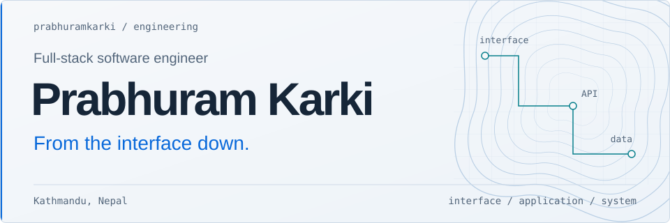

<!-- Identity -->
<h1>
  <picture>
    <source media="(max-width: 480px) and (prefers-color-scheme: dark)" srcset="assets/hero-mobile.svg">
    <source media="(max-width: 480px)" srcset="assets/hero-mobile-light.svg">
    <source media="(prefers-color-scheme: dark)" srcset="assets/hero.svg">
    
  </picture>
</h1>

I build web applications across the interface, API, and data model. My main stack is **Vue, Nuxt, Quasar, and Laravel**. I care about how a product feels to use and how its code feels to maintain.

That curiosity extends below the web stack: my public work includes a Rust coding agent and an experimental Windows application runtime for Linux.

**[Explore my portfolio](https://www.prabhuramkarki.com.np)** &nbsp; / &nbsp; [Selected work](#selected-work) &nbsp; / &nbsp; [Get in touch](#lets-build-something-useful)

## Selected work

Three projects across product development, developer tooling, and systems exploration. The links lead to source and implementation details.

### [Easy Invoice](https://github.com/prabhuramkarki/easy-invoice)

**From an invoice image to structured data.** A full-stack project that reduces manual transcription by extracting invoice fields with OCR.

My work connects a React upload interface to a Django REST API. The backend converts images to grayscale, runs Tesseract, extracts fields such as invoice number, date, vendor, and total with regular expressions, then saves the results and appends a CSV record.

`React` `TypeScript` `Tailwind CSS` `Django REST Framework` `Tesseract`

[Upload interface](https://github.com/prabhuramkarki/easy-invoice/blob/main/frontend/src/components/InvoiceForm.tsx) &nbsp; / &nbsp; [Processing pipeline](https://github.com/prabhuramkarki/easy-invoice/blob/main/backend/invoices/views.py)

### [Code Shell](https://github.com/prabhuramkarki/code-shell-rs)

**A coding agent in a native Rust CLI.** Developer tooling for working with a codebase through an interactive terminal or scripted prompts.

My work includes the terminal REPL and command handling. The workspace separates the agent loop, streaming model providers, tools, and CLI into four crates. Tool calls pass through an approval engine; filesystem edits produce diffs, and shell execution has a timeout.

`Rust` `Tokio` `SSE` `CLI` `LLM tool calling`

[Agent loop](https://github.com/prabhuramkarki/code-shell-rs/blob/main/crates/core/src/agent.rs) &nbsp; / &nbsp; [Terminal REPL](https://github.com/prabhuramkarki/code-shell-rs/blob/main/crates/cli/src/repl.rs)

### [Windows application runtime on Linux](https://github.com/prabhuramkarki/native-windows-application-runtime-on-linux)

**Exploring the boundary between an application and its host.** A pre-1.0 Linux runtime that manages Windows applications through Wine, with a separate prefix for each app.

My work includes GTK desktop controls and runtime validation. The architecture connects a CLI, a local JSON-RPC daemon, and a desktop client. It explores per-app permissions, sandboxed execution, and pinned dependency downloads with integrity checks.

**Experimental:** Wine is the only implemented backend. Compatibility evidence is limited; this is not a general replacement for Windows.

`Rust` `Linux` `Wine` `GTK 4` `JSON-RPC` `bubblewrap`

[Architecture and API](https://github.com/prabhuramkarki/native-windows-application-runtime-on-linux/blob/main/docs/API.md) &nbsp; / &nbsp; [Validation record](https://github.com/prabhuramkarki/native-windows-application-runtime-on-linux/blob/main/docs/VALIDATION.md)

## How I approach the stack

**Interface.** Component-driven Vue, Nuxt, and Quasar applications: responsive layouts, predictable state, and clear interactions.

**Application.** Laravel and Node/Express APIs: validation, authentication, authorization, business logic, and background jobs with boundaries that keep features understandable.

**Data and delivery.** Data modeling in MySQL and MongoDB, with attention to how the application is configured, deployed, and maintained.

The thread through all three: follow a feature from what the user needs to what the system must do, and keep that path easy to reason about.

## Engineering toolbox

| Where | Technologies |
| :--- | :--- |
| Main stack | Vue.js, Nuxt.js, Quasar, Laravel, PHP |
| Interface and state | TypeScript, JavaScript, React, Tailwind CSS, Redux |
| APIs | Node.js, Express, Django REST Framework |
| Data | MySQL, PostgreSQL, MongoDB |
| Tools and environments | Git, GitHub, Linux, Docker, Firebase, Azure |

Beyond the web stack

I’m learning **Rust** through developer tools and Linux runtime work. I’m interested in where application architecture meets operating-system behavior: processes, permissions, dependencies, and the boundaries between them.

I also explore **React Native** and **Arduino**, and welcome open-source collaboration.

## Development in the open

[Browse my repositories](https://github.com/prabhuramkarki?tab=repositories) &nbsp; / &nbsp; [Follow public activity](https://github.com/prabhuramkarki?tab=overview)

Follow the work through source, commit history, and the notes alongside each project.

A different view of my GitHub contributions

An animated view of my GitHub contribution calendar.

<picture>
  <source media="(prefers-color-scheme: dark)" srcset="https://raw.githubusercontent.com/prabhuramkarki/prabhuramkarki/output/github-snake-dark.svg">
  
</picture>

## Let’s build something useful

I’m open to **full-stack engineering roles, freelance projects, and open-source collaboration**. Reach out with a product to build, a system to improve, or an engineering question worth exploring.

**[prabhuramkarki07@gmail.com](mailto:prabhuramkarki07@gmail.com)**

[Portfolio](https://www.prabhuramkarki.com.np) &nbsp; / &nbsp; [LinkedIn](https://linkedin.com/in/prabhuramkarki) &nbsp; / &nbsp; [GitHub](https://github.com/prabhuramkarki) &nbsp; / &nbsp; [X](https://twitter.com/prabhuramkarki_)

